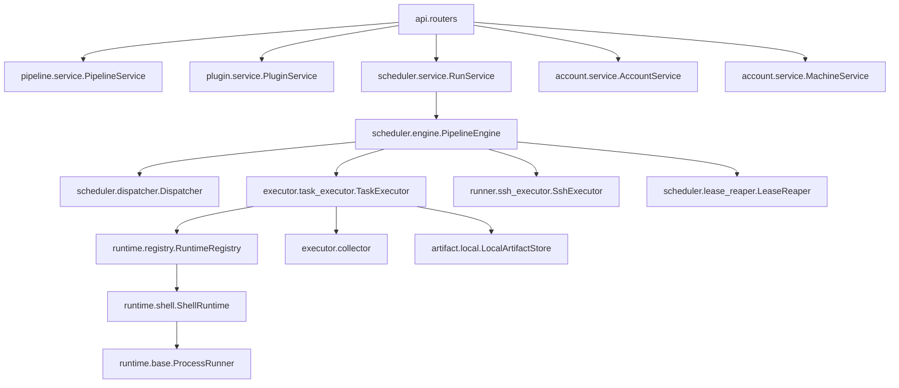

# Mini Pipeline 架构说明

## 1. 系统总体架构

`Mini Pipeline` 采用分层与双执行平面架构（Control Plane 控制平面与 Data Plane 数据执行平面清晰解耦）。

```text
               +-------------------------------------------------------------+
               |                Presentation Layer (Frontend)                |
               |       React 19 + TypeScript + Ant Design 5 + TanStack Query |
               +------------------------------+------------------------------+
                                              | REST API / SSE 流式监听
                                              v
+--------------------------------------------------------------------------------------------+
|                               Control Plane (FastAPI Backend)                              |
|                                                                                            |
|  +--------------------------------------------------------------------------------------+  |
|  |                             API & Authentication Gateway                             |  |
|  |     /api/auth/** (Public)    /api/runner/** (Machine Token)    /api/** (Bearer User) |  |
|  +------------------------------------------+-------------------------------------------+  |
|                                             |                                              |
|  +------------------------------------------v-------------------------------------------+  |
|  |                                Application Services                                  |  |
|  |  +------------------+  +-------------------+  +------------------+  +-------------+  |  |
|  |  | PipelineService  |  |   PluginService   |  |  AccountService  |  | RunService  |  |  |
|  |  | (YAML & DAG)     |  | (Source & Review) |  | (Auth & Machine) |  | (Lifecycle) |  |  |
|  |  +------------------+  +-------------------+  +------------------+  +------+------+  |  |
|  +----------------------------------------------------------------------------|---------+  |
|                                                                               |            |
|  +----------------------------------------------------------------------------v---------+  |
|  |                            Orchestration & Scheduling Engine                         |  |
|  |             PipelineEngine (DAG Coordinator, Retries, EventBus, Cancellations)       |  |
|  |                                                                                      |  |
|  |           [Coordinator Workers Pool]               [Task Workers Pool]               |  |
|  |          推进依赖状态、计算表达式                  分发本地就绪节点、构建任务包      |  |
|  +-----------------------+------------------------------------+-------------------------+  |
+--------------------------|------------------------------------|----------------------------+
                           |                                    |
          +----------------+                                    +----------------+
          | (Local Execution)                                                    | (Remote Execution)
          v                                                                      v
+------------------------------------+                 +-------------------------------------+
|      Data Plane: Local Runner      |                 |      Data Plane: Remote Network     |
|                                    |                 |                                     |
|  TaskExecutor                      |                 |  A. Pull Runner Agent (Agent Mode)  |
|   -> Workspace Layout              |                 |     mini-pipeline-runner            |
|   -> Runtime (Shell/Python/Node)   |                 |     (Outbound HTTP Long-Polling)    |
|   -> ProcessRunner (killpg/tree)   |                 |     (Lease + Heartbeat + Log Stream)|
|   -> Collector (Outputs/Artifacts) |                 |                                     |
|                                    |                 |  B. Push SSH Executor (SSH Mode)    |
|                                    |                 |     SshExecutor (Paramiko SSH/SFTP) |
+------------------------------------+                 +-------------------------------------+
                  |                                                       |
                  +---------------------------+---------------------------+
                                              |
                                              v
                              +-------------------------------+
                              |    Persistence & Storage      |
                              |  - SQLite (Dev) / Postgres    |
                              |  - LocalArtifactStore         |
                              |  - Log Files Tree             |
                              +-------------------------------+
```

---

## 2. 模块关系与依赖装配

### 2.1 依赖倒置与分层约束
依赖规则严格遵循单向依赖，禁止反向依赖与循环引用：
$$\text{API 路由层} \longrightarrow \text{应用服务层 (Services)} \longrightarrow \text{领域契约层 (Domain)} \longleftarrow \text{基础设施实现 (DB/Runtime/Storage)}$$

- **Router 层**：仅负责 HTTP 请求参数反序列化、鉴权依赖提取、状态码转换，**严禁直接操作 ORM、文件系统或子进程**；
- **Services 层**：拥有完整业务用例实现，通过事务控制保证业务一致性；
- **Domain 层**：纯 Python 实体，定义无第三方依赖的状态枚举（`RunStatus`, `TaskStatus`）、数据传输 DTO（`PluginContract`, `Resource`）和异常定义；
- **Container 装配**：核心依赖通过 `mini_pipeline.core.container.Services` 单例数据容器统一组装，各路由通过 FastAPI `Depends(get_services)` 注入使用。

### 2.2 核心模块拓扑



---

## 3. 关键数据流

### 3.1 插件注册与归档流
1. 用户或 API 提交来源（Git URL、HTTP 下载地址或上传 ZIP 文件）；
2. `SourceRegistry` 匹配到对应 `PluginSource`，将文件拉取到随机隔离临时目录；
3. `archive.py` 进行安全扫描（杜绝 Zip Slip 目录穿越、符号链接与超大炸弹）；
4. `manifest.py` 读取 `plugin.yaml`，校验输入输出资源契约（若为 v1 格式自动调用 `_upgrade_v1_to_v2` 升格）；
5. 验证通过后，将插件目录原子重命名移至持久存储区 `data/plugins/<name>/<version>`，并在数据库插入记录。

### 3.2 本地流水线 DAG 调度流
1. 提交运行（`POST /api/runs`）：`PipelineService` 验证 YAML 语法并构建拓扑图，生成 `PipelineRun` 和对应所有步骤的 `TaskRun`（初始状态为 `PENDING`），立即向客户端返回 `run_id`；
2. **Coordinator 推进**：调度器后台线程识别入度为 0（无依赖或上游依赖已全为 `SUCCESS`）的步骤，将其推进为就绪状态；
3. **参数与输入绑定**：`TaskExecutor` 建立本次执行工作区 `data/workspaces/<run_id>/<step_name>`，计算并写入 `context.json`、`params.json`、`input.json` 并展开 `input/` 资源目录树；
4. **子进程执行**：`ProcessRunner` 启动插件入口进程，启动多线程流式泵将 stdout/stderr 写入日志文件并发布事件；
5. **产物收集与状态合并**：进程退出后，`collector.py` 严格校验声明的 `output/` 资源与 `output.json`，将产物转存并哈希归档；
6. **解锁下游**：当前步骤置为 `SUCCESS`，触发协调器继续解锁下一批依赖节点，直至整条流水线收敛为 `SUCCESS` 或 `FAILED`。

### 3.3 远程 Runner Agent（Pull 模式）数据流
1. **任务认领（Claim）**：
   - 目标机上运行的 `mini-pipeline-runner` 周期性（默认 1.5s）向平台发起 `POST /api/runner/tasks/claim`；
   - 平台采用数据库级原子条件检查（`UPDATE ... WHERE status='QUEUED' AND machine_id=...`），找到就绪任务并原子置为 `RUNNING`，赋予初始租约时长（`lease_expires_at`）；
   - 任务输入的崩溃恢复：引擎在任务停入 QUEUED 时将已解析输入（params、run_params、依赖结果、uploads、超时、machine_id）持久化到 `data/remote_state/<task_id>.json`；API 重启后认领与拉包通过 `PipelineEngine.remote_inputs_for()` 从磁盘状态文件 + 数据库重建，不再依赖进程内存；任务到达终态后自动删除状态文件。
2. **任务包下发（Bundle）**：
   - Agent 请求 `GET /api/runner/tasks/{id}/bundle`；
   - 平台在内存与临时目录组装包含插件源码及已解析输入资源的工作空间 ZIP 包下发；
3. **远端执行与心跳（Execute & Heartbeat）**：
   - Agent 本地解压工作区，调用本地 `ProcessRunner` 运行插件；
   - Agent 专属后台线程每隔 15 秒向 `POST /api/runner/heartbeat` 发送心跳，延长租约过期时间，并拉取平台的取消信号（若用户取消，心跳回包携带 `cancel_task_ids`，Agent 立即杀掉本地进程树）；
   - `LogTee` 将插件标准输出缓冲分批 POST 回送服务端追加到日志文件；
4. **终态回报与产物回传（Report & Upload）**：
   - 任务执行完毕，Agent 收集本地输出与产物，通过 multipart POST 上传产物文件；
   - Agent 调用 `POST /api/runner/tasks/{id}/status` 提交最终退出状态与输出 JSON；
   - 服务端引擎更新数据库，发布状态事件，推进后续 DAG。

### 3.4 远程 SSH 直连（Push 模式）数据流
1. **免 Agent 触发**：任务调度检测到目标机器 `connection_type == 'ssh'`；
2. **凭证解密与建连**：后端从数据库中读取并使用 `security.secret_key` 解密 SSH 账号密码或私钥，利用 `Paramiko` 建立 SSH 与 SFTP 客户端；
3. **打包分发**：服务端本地将任务执行上下文打成 ZIP 包，通过 SFTP 上传至远程服务器临时目录（如 `/tmp/mini-pipeline-runner/...`）并解压；
4. **远端执行与监控**：通过 SSH channel 触发远端入口脚本，异步消费远端 stdout/stderr 流回写服务端本地日志；
5. **远程收集**：任务完成后通过 SFTP 将远端生成的 `output/` 目录和 `output.json` 同步回拉至服务端本地，走完全相同的本地 Collector 解析流程。

### 3.5 制品与通用存储子系统（Storage Subsystem & Storage Isolation）

#### 1. 存储分区与隔离架构（物理拓扑）
平台在根数据目录（或对象存储）下对所有数据资源进行了严格的职责划分与物理目录隔离：
| 存储目录 | 核心职责 | 访问控制与生命周期 | 是否与制品仓冲突 |
| :--- | :--- | :--- | :--- |
| `data/packages/` | **制品仓库（Package Hub）**：用户上传的通用制品、配置文件、数据集、母包、杂项工具包 | 用户/组织自主管理，持久存储，支持读写编辑与外部挂载 | **基准存储区** |
| `data/plugins/` | **插件运行时（Plugin Store）**：已校验注册并激活的插件执行包（`<name>/<version>/`） | 平台管理，安装后只读，受插件市场版本约束与元数据锁定 | **物理隔离，绝不冲突** |
| `data/workspaces/` | **任务执行空间（Workspaces）**：每次 Run/Task 的沙盒执行目录（`<run_id>/<task_id>/`） | 动态创建，任务执行期间读写，任务结束后归档或清理 | **物理隔离，绝不冲突** |
| `data/artifacts/` | **流水线产物归档（Run Artifacts）**：流水线成功产出并上报的制品物料 | 按流水线运行记录结构化归档，不可变只读 | **物理隔离，绝不冲突** |
| `data/logs/` | **执行日志（Logs）**：每个任务的 stdout/stderr 实时日志流（`<run_id>/<task_id>.log`） | 仅追加写入与按需消费，支持日志滚动策略 | **物理隔离，绝不冲突** |
| `data/tmp/` | **临时刮擦暂存（Temp）**：插件注册解压校验、大文件流式中转 | 短生命周期，操作完成即刻原子清理 | **物理隔离，绝不冲突** |

#### 2. 存储驱动抽象（StorageDriver）
- 抽象接口统一：`list_dir`、`get_file_stream`、`read_text`、`write_file`、`write_text`、`create_dir`、`delete`、`stat`；
- **LocalStorageDriver**：支持本地宿主机文件目录，实施严格的根目录沙箱隔离（`is_relative_to(root)`，杜绝 `..` 越权访问），支持多编码兜底读取与临时文件原子安全写入；
- **S3StorageDriver**：纯 Python 标准库 + `httpx` 实现 AWS SigV4 签名，零依赖对接 AWS S3、MinIO、阿里云 OSS、腾讯云 COS、Cloudflare R2；

#### 2.1 运行产物存储后端（ArtifactStore Backend）
- 运行产物（Run Artifacts）的物理存储位置由 `ArtifactStore` 协议（`mini_pipeline/artifact/base.py`）抽象，`Services.build` 按 `artifact_storage.driver` 配置选择：
  - **LocalArtifactStore**（默认）：产物落盘 `data/artifacts/<run_id>/<task_id>/<artifact_id>/content`；
  - **S3ArtifactStore**：产物写入对象存储桶 `<prefix>/<run_id>/<task_id>/<artifact_id>/content`，复用 `S3StorageDriver` 传输与 SigV4 签名（零 boto3 依赖）；
- 无论后端为何，数据库 `artifacts.storage_path` 统一记录「本地绝对路径」或「S3 对象键」，产物下载 API（不透明 `artifact_id` + SHA256 ETag / 304）完全不变；上传时数据库写入失败自动回滚删除已写对象；

#### 3. 制品中心与流水线双向闭环协同（Bi-directional Integration）
制品仓库不再是孤立的网盘，而是全平台贯通的资产枢纽：
1. **资产上行：运行产物一键归档到制品仓**：
   - 接口：`POST /api/artifacts/{id}/publish-to-packages`
   - 用户在流水线运行详情或产物列表中，可一键将构建出来的产物持久化归档到制品仓库指定目录（如 `artifacts/build-v1.0.tar.gz`），供后续版本沉淀与团队共享；
2. **资产下行：流水线步骤直接消费制品仓文件**：
   - 协议扩展：`ResourceSource.PACKAGE = "package"`；
   - 插件或流水线定义可在 `inputs` 中声明 `source: package`，指定制品仓中的相对路径（如 `datasets/base.csv` 或 `models/weights.bin`），Executor 执行前自动将对应文件装配至工作区 `input/` 目录，无需每次运行重复上传；
3. **插件孵化：制品一键发布为平台插件**：
   - 制品中心发现带有 `plugin.yaml` 的 ZIP 包或目录时自动标记为 `Plugin Candidate`；
   - 支持一键将制品库内的包注册入平台插件市场（`PluginService.register_upload`），实现从资产库到流水线组件的无缝流通。


---

## 4. 关键接口与契约规范

### 4.1 插件执行环境规范（Workspace Layout）
任何在平台或 Runner 上执行的插件，均拥有标准隔离的工作目录结构：
```text
workspace/
├── context.json       # 平台元数据（run_id, task_id, step_name, attempt 等）
├── params.json        # 运行级全局参数 + 步骤级覆盖参数（纯字典）
├── input.json         # v1 协议兼容输入（含 params 与上游 outputs）
├── input/             # v2 资源输入目录树（按 input 声明键名分目录存储文件/值）
├── output/            # v2 插件产物输出目录（文件型产物置于此处）
├── output.json        # 可选：v1 结构化输出（status, outputs, artifacts, metrics）
├── temp/              # 任务临时刮擦空间（执行后清理）
├── cache/             # 任务缓存空间
└── logs/              # 运行时进程日志
```

### 4.2 流水线表达式契约（Expression Resolver）
表达式解析器仅严格支持三类访问语法，任何非法前缀均会在提交时拒绝：
1. `${{ params.<key> }}`：提取流水线运行参数；
2. `${{ steps.<step_name>.outputs.<output_name> }}`：精准提取指定直接前置步骤的单一输出；
3. `${{ all.deps.outputs.<output_name> }}`：扇入（Fan-in）聚合所有前置步骤的同名输出，序列化为 JSON List 传递。

### 4.3 产物访问协议
- 接口形式：`GET /api/runs/{run_id}/artifacts/{artifact_id}`；
- **路径不可见性**：客户端永远只能拿到无含义的 UUID `artifact_id`，杜绝文件系统结构泄露；
- **高效传输**：响应头强制携带 SHA256 `ETag`，命中客户端缓存时直接响应 `304 Not Modified`。

### 4.4 内容寻址执行缓存协议（Content-Addressed Step Cache）
- **触发条件**：Step 声明 `cache: true` 时生效；
- **Cache Key 算法**：
  ```text
  CacheKey = SHA256(
      plugin.name + plugin.version +
      manifest_bytes +
      json.dumps(sorted_params) +
      json.dumps(sorted_dependencies)
  )
  ```
- **生命周期**：
  1. 调度器在推进 `_advance_ready` 时计算 Key；
  2. 若 `TaskCacheRepository` 中存在记录：直接将 `TaskRun` 标为 `SUCCESS`，写入 `[CACHE HIT]` 日志，复用历史 outputs 与 artifacts 并解锁下游 DAG；
  3. 若未命中：正常派发执行，并在任务成功时持久化存入 `task_cache` 表。

### 4.5 Docker 容器运行时协议（Docker Runtime）
- **触发条件**：插件 `plugin.yaml` 中声明 `runtime.type: docker` 与 `runtime.image`；
- **工作区挂载**：容器启动命令携带 `-v <cwd>:/workspace -w /workspace`，并在容器内重写 `PIPELINE_WORKSPACE`、`PIPELINE_CONTEXT` 等环境变量；
- **资源清理**：执行超时或被取消时，调度器执行 `ProcessRunner` 终止后追加执行 `docker rm -f <container_name>` 进行容器实例强制回收。

---

## 5. 重要技术约束与架构铁律

1. **严格的环境变量展开**：
   - YAML 配置文件加载时采用严苛解析机制。任何写在配置中的 `${ENV_VAR}` 若环境变量不存在，系统启动或初始化即刻崩溃抛出异常，不允许静默退化为空串。
2. **双线程池配比与防死锁**：
   - `coordinator_workers`（推进拓扑图）与 `task_workers`（执行具体工作）物理分离，严防多个长运行协调线程吃光所有执行线程引发全局饥饿死锁。
3. **整树终止保障**：
   - 任务超时、被用户主动取消时，必须保证子进程及其派生的所有孙子进程一并销毁。POSIX 环境必须调用 `os.killpg`，Windows 环境必须调用 `taskkill /F /T /PID`。
4. **启动孤儿收割原则**：
   - 由于进程内调度状态不具备外部分布式持久锁，服务节点重启后遗留的 `PENDING` 或 `RUNNING` 运行记录必须在启动阶段统一收割标记为 `FAILED`（`reap_orphans_on_start`），避免前端出现永恒转圈任务。
5. **数据传输分页信封**：
   - 所有返回集合的列表类 REST 接口必须统一包装为分页信封结构：`{ items, total, page, page_size, pages }`，前端与外部调用方严禁作为裸数组消费。
6. **前端 TypeScript 严苛模式**：
   - 前端全面启用 strict 模式，`noExplicitAny` 为最高级别阻断错误（Error 而非 Warning），保证全链路类型推导的安全闭环。
